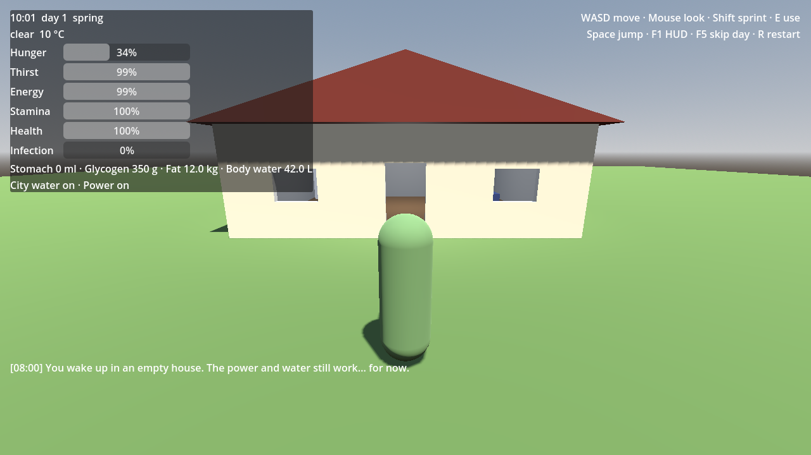
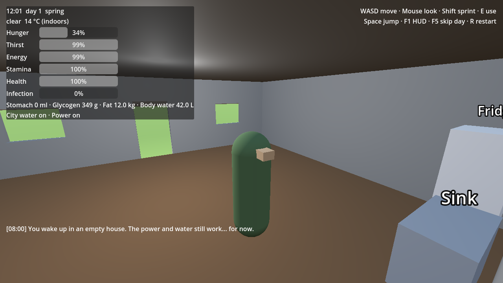

# Signal Weaver — S1 "One house" (Godot 4.4)

Our own survival prototype, built clean-room from the systems in `../sim/` (see `../notes/recreate-plan.md`). No Vein code, art or data — everything is generated in code from primitive shapes.




## Run it
1. Install **Godot 4.4** (standard build, not .NET): https://godotengine.org/download
2. Open Godot → **Import** → pick `game/project.godot` → **Run** (F5).

## Controls
| Key | Action |
|---|---|
| WASD / mouse | Move / look (click to capture the mouse, Esc to release) |
| Shift | Sprint (burns stamina, glycogen, sweat) |
| E | Use the nearest thing: **Fridge** (eat), **Sink** (drink 250 ml), **Bed** (sleep, fast-forward), **Toilet** |
| Space | Jump |
| F1 | Full debug HUD ↔ minimal HUD (only extremes, like Vein 0.021) |
| F5 | Skip a day |
| R | Restart |

## What's simulated
- **Body** (`sim/body.gd`): stomach → intestine → colon, glycogen, fat, muscle, body water, bladder — the realistic digestion model.
- **Survivor** (`sim/survivor.gd`): fatigue, stamina, health, infection; walking/sprinting/sleeping change your metabolism.
- **World**: day/night sun and moon, seasons, hourly weather, indoor vs outdoor temperature, city water off on **day 30**, power off on **day 46** (the lamp goes out).
- **Pantry**: finite food in the kitchen — when it's gone, it's gone.
- 1 real second = 1 game minute (24-minute days); sleeping runs 30× faster.

## Tests
```
tools/scripts/test_game.sh /path/to/godot
```
- `tests/run_tests.gd` — **210 golden checks**: the GDScript port must match the Python models (`python tools/scripts/gen_golden.py`) to 1 part in a million, plus behaviour checks.
- `tests/smoke_test.gd` — loads the real scene and plays it: walk to the fridge and eat, drink at the sink, sleep and wake, skip a day, tap dies after day 30, indoors/outdoors.
- Main scene runs 300 frames with zero errors.

## Next (S2)
One zombie that sees, hears and smells you (`../sim/zombies.py`), plus infection from hits.
